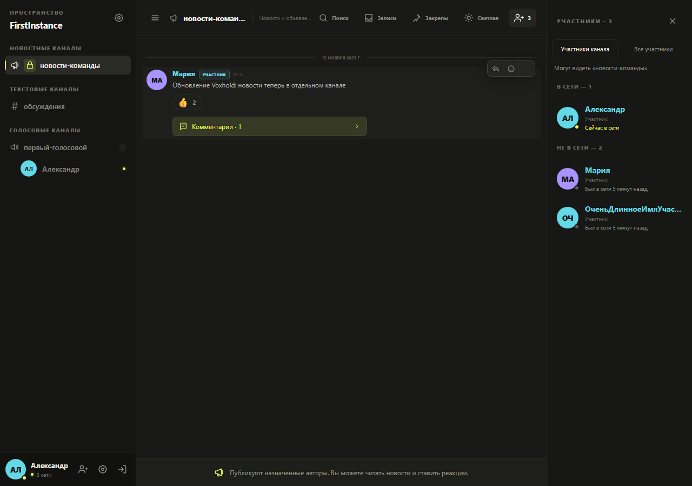
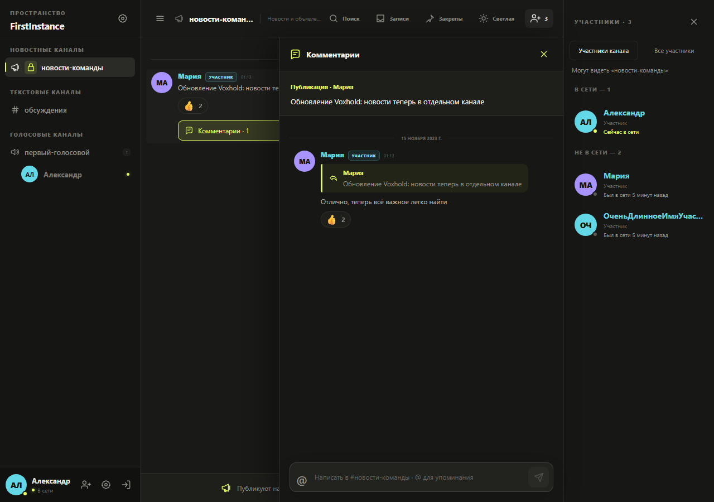
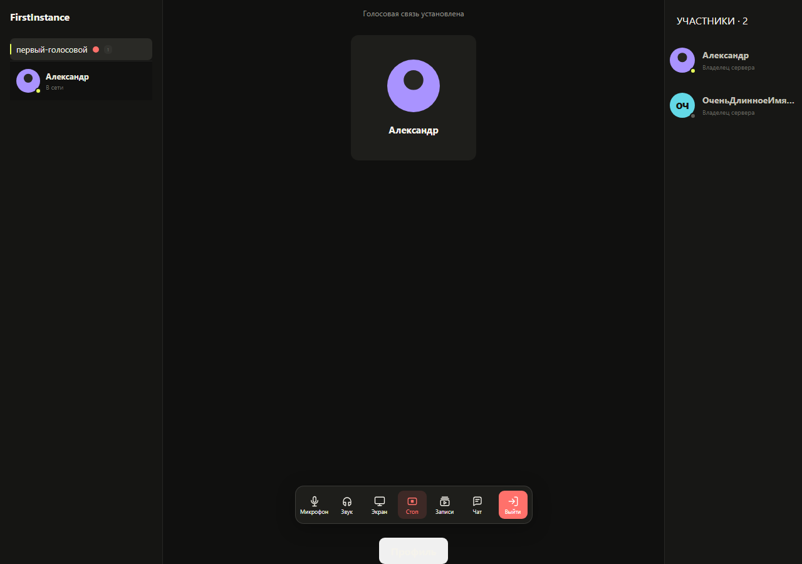

[English](README.md) | Русский

# Frontend Voxhold

Веб-клиент для собственного инстанса Voxhold на React, TypeScript и Vite.
Подключается к HTTP API, WebSocket и WebRTC backend.

**Связанные репозитории:** [Backend](https://github.com/LoonEman1/voxhold-backend)
· [Развёртывание](https://github.com/LoonEman1/voxhold-deploy).

В backend находятся API и миграции базы. В deploy — установка всего приложения
на Linux-сервер с HTTPS, резервными копиями, TURN и согласованными обновлениями
из опубликованных образов.

## Возможности

- Регистрация по приглашению, сессии, профили и аватары.
- Пространства с ролями, приватными каналами и настройками доступа.
- Текстовые, голосовые и новостные каналы. Группа новостных каналов находится
  сверху и появляется только при наличии доступного новостного канала на сервере.
- Назначение авторов новостей, реакции и включаемые обсуждения под публикациями.
  Читатели ставят реакции; администратор выбирает авторов и управляет комментариями.
- Ответы, пересылка, реакции, редактирование, удаление, закрепы и поиск сообщений.
- Отметки прочтения и сохраняемые счётчики непрочитанных уведомлений до `99+`.
- Голос WebRTC, управление микрофоном/звуком, серверная и P2P демонстрация экрана.
- Записи каналов с локальными и серверными копиями, превью и повторным скачиванием.
- Светлая и тёмная темы, изменяемые боковые панели, мобильный интерфейс и восстановление медиа.

Федерация пока существует как
[концепция](https://github.com/LoonEman1/voxhold-backend/blob/main/docs/federation-concept.ru.md).
В опубликованные возможности клиента она не входит: эта версия подключается
к одному инстансу.

## Примеры интерфейса

Скриншоты сняты на воспроизводимых тестовых данных с демонстрационными аккаунтами.

### Новости и закрытые каналы



<details>
<summary>Комментарии к публикации и управление звонком</summary>

Обсуждение открывается рядом с лентой. При отключении комментариев история
остаётся доступна для чтения.



В панели звонка подписаны микрофон, звук, экран, запись, архив, чат и выход.



</details>

## Быстрый запуск с готовым backend

Нужны Docker Engine и Docker Compose v2. По умолчанию контейнер ожидает backend
по адресу `host.docker.internal:8080`.

```bash
cp .env.example .env
docker compose up --build -d
```

Откройте [http://localhost:3000](http://localhost:3000). Nginx отдаёт SPA и
проксирует `/api` и WebSocket в backend. Если backend находится на другом
хосте или порту, задайте `BACKEND_UPSTREAM` в `.env`.

Для полного локального стека клонируйте frontend и
[backend](https://github.com/LoonEman1/voxhold-backend) в соседние каталоги
`Voxhold-frontend` и `Voxhold-backend`, затем из каталога frontend выполните:

```bash
docker compose -f compose.fullstack.yaml up --build -d
docker compose -f compose.fullstack.yaml logs bootstrap
```

Если `BOOTSTRAP_PASSWORD` не задан, сохраните сгенерированный пароль владельца.
Остановить стек без удаления SQLite volume:

```bash
docker compose -f compose.fullstack.yaml down
```

Для публичной установки используйте
[Voxhold deploy](https://github.com/LoonEman1/voxhold-deploy/blob/main/README.ru.md).
Вне localhost браузеру нужен HTTPS для микрофона и захвата экрана. Откройте
UDP `50000` для голоса и `50001` для демонстрации, а в `WEBRTC_PUBLIC_IP`
укажите адрес, доступный вашим пользователям.

## Приглашения и доступ

Приглашение имеет веб-адрес вида `https://chat.example.com/#/invite/TOKEN`.
Страница проверяет токен и предлагает продолжить в браузере либо явно открыть
нативный клиент. Для регистрации нужно действительное приглашение. Адрес
инстанса сам по себе не даёт членства и доступа к каналам. Владелец и
администраторы могут просматривать и отзывать активные ссылки.

Предпочтителен один публичный origin для frontend и `/api`. Для отдельного
веб-клиента владелец может разрешить его origin в настройках доступа внешних
клиентов. Backend применяет список CORS/Origin в рантайме.

## Локальная разработка

Нужны Node.js 24, npm и запущенный backend.

```bash
npm ci
cp .env.example .env
npm run dev
```

Проверки:

```bash
npm run typecheck
npm run lint
npm test
npm run build
```

Браузерные проверки используют Playwright и изолированные тестовые данные;
рабочий backend им не нужен:

```bash
npx playwright install chromium
npm run test:e2e:ui
npm run test:e2e:performance
```

## Конфигурация

| Переменная | По умолчанию | Назначение |
| --- | --- | --- |
| `VITE_API_BASE_URL` | пусто | Origin API при сборке; пустое значение использует same-origin `/api`. |
| `VITE_DEV_API_PROXY` | `http://localhost:8080` | Backend для Vite в режиме разработки. |
| `BACKEND_UPSTREAM` | `host.docker.internal:8080` | Backend, доступный Nginx из контейнера. |
| `FRONTEND_PORT` | `3000` | Порт сайта на хосте. |
| `WEBRTC_PUBLIC_IP` | `127.0.0.1` | Адрес backend, публикуемый медиаклиентам локального стека. |
| `WEBRTC_UDP_PORT` | `50000` | UDP-порт голоса в локальном fullstack Compose. |
| `WEBRTC_STREAM_UDP_PORT` | `50001` | UDP-порт демонстрации в локальном fullstack Compose. |

ICE/TURN клиент получает в рантайме через `GET /api/v1/webrtc/config`.
При изменении ICE backend пересобирать frontend не нужно. Лимиты медиа, TURN
и production-настройки описаны в [`.env.example`](.env.example) и
[конфигурации deploy](https://github.com/LoonEman1/voxhold-deploy/blob/main/.env.example).

HTTP transport и адаптер хранения сессии находятся в
[`src/platform/transport.ts`](src/platform/transport.ts), WebSocket-клиент —
в [`src/services/realtime.ts`](src/services/realtime.ts).

## Релизы и обновление

Frontend и backend выпускаются с общим номером **2.5.1**. Перед этим frontend
установите backend **2.5.1** и примените миграции **000027–000031**. Они добавляют
роли, подписки обсуждений, личные беседы и вложения. Перед обновлением сохраните проверенный бэкап.

Образ frontend: `ghcr.io/looneman1/voxhold-frontend:2.5.1`.
Теги `2.5` и `latest` перемещаются при публикации новых релизов.
Для существующей production-установки:

```bash
./update.sh --backend-version 2.5.1 --frontend-version 2.5.1
```

Команда запускается из [репозитория deploy](https://github.com/LoonEman1/voxhold-deploy),
а не из исходников frontend. Перед обновлением прочитайте
[описание релиза](RELEASE_NOTES.md) и
[общий порядок выпуска](docs/release-workflow.md). Изменения проходят PR в `dev`,
затем релизный PR в `main`; успешный CI автоматически публикует образы, теги и GitHub Releases.

## Документация

- [История каналов, синхронизация и повторы отправки](docs/channel-history.md)
- [Приватные каналы и карточки трансляций](docs/channel-access-and-stream-tiles.md)
- [Ответы, пересылка и реакции](docs/message-interactions.md)
- [Настройки уведомлений](docs/channel-notifications.md)
- [Новостные каналы, права, комментарии и API счётчиков](https://github.com/LoonEman1/voxhold-backend/blob/main/docs/news-channels.md)
- [Звонки, записи и аватары](docs/calls-recordings.md)
- [Восстановление медиа и участники каналов](docs/media-recovery-and-members.md)
- [Производительность клиента](docs/client-performance.md)
- [Участие в разработке](CONTRIBUTING.ru.md)


Community 2.3: [attachments, conversations, inbox, roles and text threads](docs/community-2.3.md).

При отдельном origin API задайте `CSP_CONNECT_EXTRA=" https://api.example.com wss://api.example.com"` в окружении frontend-контейнера и `VITE_API_BASE_URL` при сборке. По умолчанию CSP разрешает соединения только с текущим origin. HSTS настраивается на HTTPS-прокси.

[Исправления аудита и проверки](docs/audit-2.5-fixes-status.md). Перед согласованным обновлением необходимо выполнить миграцию backend **000032**.
